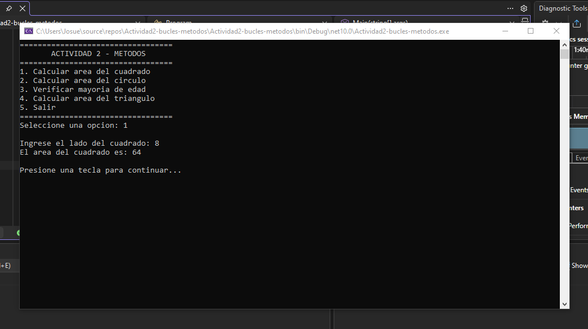
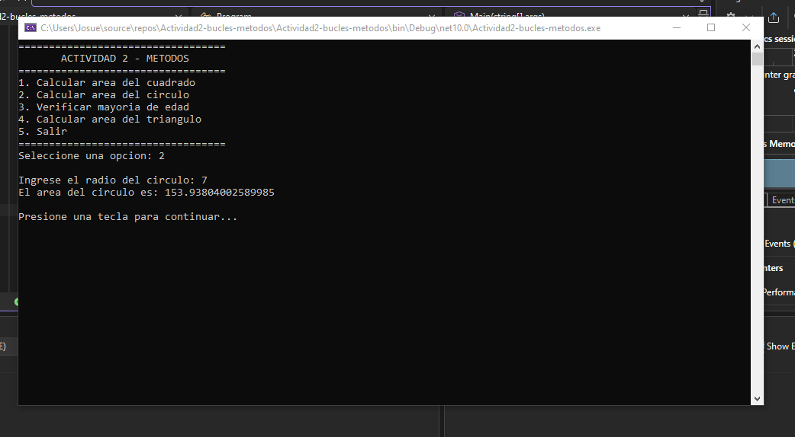
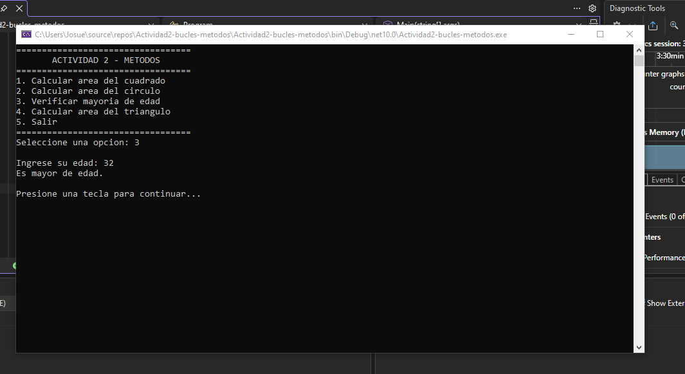
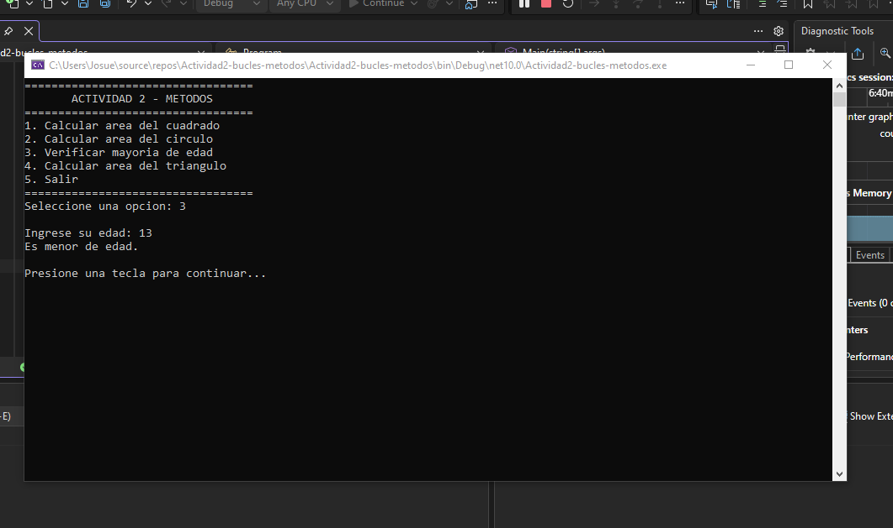
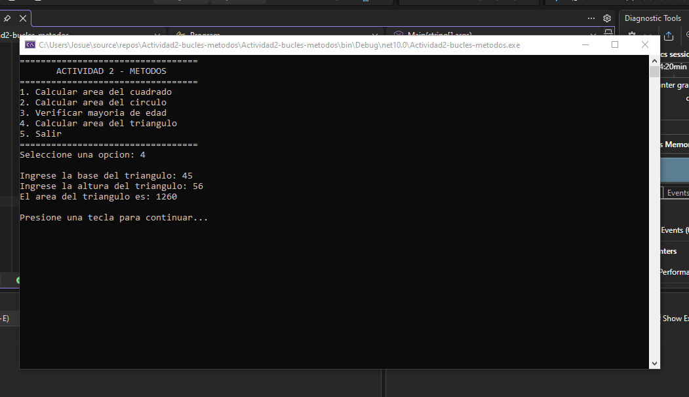

# ACTIVIDAD 2 – CONTROL DE FLUJO DE UNA APLICACIÓN

## Autores
- Nombre: Josue Alfredo Trinidad Jimenez – Matrícula: 26-EISN-2-016
- Nombre: Jumariel Esmeralda Rijo Pascual – Matrícula: 26-EISN-2-015
- Nombre: Steven Mathei – Matrícula: 26-EISN-2-017
- Nombre: Miguel Emanuel Cedano – Matrícula: 26-EISN-2-027
- Nombre: Lucero Esthefani De Jesús – Matrícula: 25-SISN-2-034

## Descripción del programa
Este programa fue desarrollado en C# utilizando una aplicación de consola. Su objetivo es realizar diferentes operaciones mediante funciones y métodos. El usuario puede seleccionar una opción desde un menú para calcular áreas geométricas o verificar si una persona es mayor o menor de edad.

## Datos de entrada
Los datos que solicita el programa son:
- Lado del cuadrado.
- Radio del círculo.
- Edad de la persona.
- Base y altura del triángulo.
- Opción seleccionada en el menú.

## Datos que procesa
El programa procesa los valores introducidos por el usuario utilizando cuatro funciones:
- AreaCuadrado: calcula el área de un cuadrado.
- CalcularAreaCirculo: calcula el área de un círculo.
- VerificarEdad: determina si una persona es mayor o menor de edad.
- CalcularAreaTriangulo: calcula el área de un triángulo.

## Datos de salida
El programa muestra en pantalla:
- El área del cuadrado.
- El área del círculo.
- Un mensaje indicando si la persona es mayor o menor de edad.
- El área del triángulo.
- Mensajes de confirmación y opciones del menú.

## Capturas de pantalla

### 1. Cálculo del área del cuadrado

### 2. Cálculo del área del círculo

### 3. Verificación de mayoría de edad

### 4. Verificación de menor de edad

### 5. Cálculo del área del triángulo

## Lenguaje y herramientas utilizadas
- Lenguaje: C#.
- Entorno de desarrollo: Visual Studio.
- Plataforma: Aplicación de consola.
- Control de versiones: GitHub.